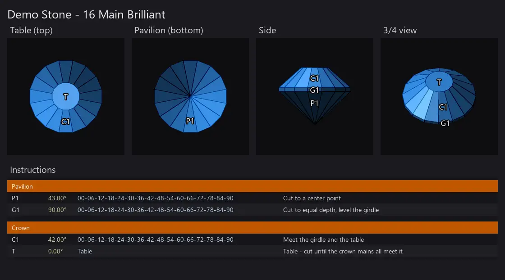

# GCS Viewer

[](https://github.com/loydb/GCSViewer/actions/workflows/tests.yml)
[](https://github.com/loydb/GCSViewer/releases/latest)

Look at a faceted gem design without opening the program that cut it.

**[⬇ Download GCSViewer.exe](https://github.com/loydb/GCSViewer/releases/latest/download/GCSViewer.exe)** —
Windows, nothing to install. Double-click a `.gcs` or `.gem` file and the
stone is on screen: four shaded views and the cutting instructions.

If you open designs all day, take the **folder build** from the
[releases page](https://github.com/loydb/GCSViewer/releases/latest) instead —
it starts in a third of the time (427 ms against 1,534 ms), because the single
file unpacks itself into `%TEMP%` on every launch.



*`docs/Implaid.gcs` — Implaid, a cushion by Loyd Blankenship — opened in the
viewer. The last panel is live: drag to turn the stone, arrow keys to tip it.
The checkbox under the panels swaps the material colour for a colour per tier.*

## Why

Faceting design files are geometry, not pictures, so a folder of them is a
folder you cannot see — and finding one stone means opening candidates in a
design program one at a time. This makes them behave like photos: double-click
one, arrow through the folder, close it.

## About Gem Cut Studio

[**Gem Cut Studio**](https://gemcutstudio.com/), by **Rej Poirier**, is design
software for faceted gemstones — *"gem design, in real-time"*, in its own words.
You work in the terms a faceter actually cuts to — tiers, angles, index gear —
and see the finished stone rendered as you go, so a design can be judged on
screen before anything is ground against a lap. Its designs are the `.gcs`
files this viewer opens, and the tier / angle / index table under the renders
is the same vocabulary as its cutting-sequence panel — though the tier names
here are derived rather than copied, so they may not match the ones a design
was written with (see below).

GCS Viewer is an independent tool. It is not affiliated with Gem Cut Studio or
GemCad, it only reads their files, and it never modifies what it opens.

## What it shows

Four orthographic, flat-shaded panels, tinted with the material colour stored
in the file:

| Panel | View |
|---|---|
| **Table (top)** | straight down the optic axis |
| **Pavilion (bottom)** | straight up at the culet, lit from below |
| **Side** | the girdle profile |
| **3/4 view** | angled — drag to turn it, arrow keys to tip it |

Below them the **cutting sequence** — tier, angle, index list and the
instruction the file carries — grouped into Pavilion and Crown.

Name, angle, section and index list are all derived from the geometry rather
than read from the file, so they appear even for designs that store no
instructions. Index positions come from each facet normal against the gear in
the file (96 by default): a normal at 22.5° on a 96 gear is index 06.

**Tiers are named the way faceters name them** — `P1`, `P2`, … on the pavilion,
`G1`, `G2`, … on the girdle, `C1`, `C2`, … on the crown, `T` for the table —
numbered in the order they are cut. Files rarely agree on this: GemCad writes a
running lower-case alphabet (`a`, `b`, `c`, …), which says nothing beyond "the
third one" and says even less if that alphabet is not the one you read; others
number tiers `1`, `2`, `3` with no sign of which end of the stone they are on.
`P`, `G` and `C` name the part of the stone, and the number is the cutting
order, so a design reads the same whatever wrote it.

The tier names stored in a file are not shown. They are never modified either —
what the viewer opens, it never writes to.

A panel with nothing facing it says so, which is not always a fault — a preform
has no crown yet, so there is genuinely nothing to draw from above.

Rendering is deliberately flat and matte: a painter's algorithm with back-face
culling, a fixed light — mirrored below the girdle for the pavilion panel, which
would otherwise sit in its own shadow — and a specular highlight. No refraction,
no dispersion. Flat shading shows the facets, and a meet that does not meet
stays visible instead of disappearing into a sparkle.

**Colour-code tiers** — the checkbox above the cutting instructions, or **C** —
paints every facet by the tier it belongs to instead of by the material, each
tier its own pastel, named in its own colour. It answers a different question
from the material view: not what the stone will look like, but which facets
belong to the tier you are about to cut, and whether the one you just cut
landed where you meant it to. Shading is flatter in this mode so a tier stays
the same colour on the facets turned away from the light. Every design gets
its own colours, and they do not change between runs.

The window opens with them on; untick the box, or start with
`--no-tier-colors`, for the material colour the file names. A saved sheet is
the other way round — it follows the window when you press **S**, and stays
on the material colours for `--save` unless you ask with `--tier-colors`.

**Ten colour sets**, from **Color Blindness Mode** at the **top right** of
the window, above the stone — the same ones
[facetdiagrams.org](https://facetdiagrams.org) offers. Two for normal vision
(*None (Pastel)*, this viewer's own colours, and *None (Vibrant)*, the
website's), and one for each of eight kinds of colour blindness:
deuteranomaly, protanomaly, deuteranopia, protanopia, tritanomaly,
tritanopia, achromatopsia and blue cone monochromacy. The last two are drawn
**unshaded**, because lightness is the only cue those viewers have and
shading would spend it.

It is named for the sight it serves rather than for what the viewer
paints, and is set larger and brighter than the toggles under the stone: a
control for people who may not see the difference between two tier colours
has no business being the dimmest thing on screen.

The button face carries the short name of the set that is on; the menu
carries the full one, with the plain-English gloss beside the clinical name,
because the menu is where the choice is made. The button is a fixed width, so
the control does not move about as the set changes.

The colours are not handed out in tier order — that would put near-alike
colours on neighbours, which is the one thing the sets exist to prevent.
Tiers that TOUCH (sharing a facet edge, not just a corner) are kept at least
10 CIEDE2000 apart *as that viewer sees them*, and among the colours that
qualify a tier takes the least-used one, so a design still shows variety.
A set holds 16 colours, 12 for the monochromacies, and a design with more
tiers than that reuses a colour on tiers that do not touch.

**The set you pick is remembered** — the window opens on it next time.
`--palette=ID` chooses one for a single run and `--palettes` lists them. A
`--save` from the command line always takes the default unless `--palette=`
says otherwise, so a sheet rendered by a script does not change because
somebody picked a different set in the window last week.

The sets and their distance tables come from Loyd's tier-colour research
(*Tier Colors and Color Blindness*), and `scripts/gen_tier_sets.py` generates
`tier_sets_data.py` from the same `palettes.json` the website generates its
copy from, so no colour is typed by hand in either program and the two
cannot drift apart.

**Frosted facets** — the matte bands an edge-frosting tool leaves — draw
without the highlight and under a fine stipple, so they are distinguishable
from polished facets at a glance in all three themes. Under tier colours,
where every facet of a tier is one flat pastel, a frosted one keeps its
tier's hue but blooms toward white and takes a firmer stipple — the tint is
pale and flat by design, and the material theme's dot disappears into it.
Their edges stay drawn, which is the point of looking at a frosted design:
a facet the tool consumed leaves a visible hole rather than a plausible stone.

## Formats

| | |
|---|---|
| **`.gcs`** | Gemcut Studio XML. Facets, tiers, instructions, material colour. |
| **`.gem`** | GemCad binary — **reverse-engineered**, no published spec. |

The `.gem` reader recovers the title, three header lines and four footer
lines from a trailing block of length-prefixed strings - eight fixed slots,
an unused one being empty rather than absent - and prints them along the
foot of the sheet, since that is often all a `.gem` says about itself. It
also recovers the refractive index and the index gear from the same tail. Face normals are recomputed
with Newell's method, because the stored ones cannot be relied on.

There is no `.asc` support, by design.

## Controls

| Key | Does |
|---|---|
| **← →** | previous / next design in the folder, wrapping, in Explorer's sort order |
| **drag** | turn the 3/4 view left and right |
| **↑ ↓** | tip the 3/4 view up and down |
| **I** | show / hide the instructions table |
| **C** | colour-code the tiers, on at startup (also the checkbox above the table) |
| menu | which of the ten colour sets to use; remembered for next time |
| **G** | grayscale |
| **L** | tier labels |
| **S** | save the sheet as a PNG next to the design |
| **R** | reset the 3/4 angle |
| **Esc** / **Q** | close |

Files it cannot read are skipped while arrowing, rather than stopping the walk.

## Install

`GCSViewer.exe` needs nothing installed — no Python, no numpy, no Pillow.

1. Put it somewhere permanent, e.g. `C:\Tools\GCSViewer\`.
2. Register it, from that folder:

   ```powershell
   powershell -ExecutionPolicy Bypass -File .\Install-GcsViewer.ps1
   ```

That also gives `.gcs` and `.gem` files a gem icon instead of Explorer's blank
page, and adds a Start Menu entry which asks for a design when launched without
one.

## Make it the default

Windows lets only you set a default handler, not the program itself — the
setting is hash-protected so that applications cannot claim file types behind
your back.

Right-click a `.gcs` file → **Open with** → **Choose another app** → **GCS
Viewer** → **Always**, and repeat once on a `.gem` file. If **Always** is
greyed out, select the app first; if GCS Viewer is not listed, scroll to the
bottom for **Choose an app on your PC** and browse to `GCSViewer.exe`.

Gem Cut Studio stays available on both types through **Open with**.

If double-click shows the picker and choosing the viewer does nothing, re-run
`Install-GcsViewer.ps1` — versions 1.0.19 to 1.0.25 registered the file type
without a default action, and re-running repairs it.

To check the registration without opening dialogs:

```powershell
powershell -ExecutionPolicy Bypass -File .\scripts\Show-OpenWithList.ps1
```

It prints what Windows would offer for both extensions, whether a double-click
resolves to a program that exists, and any stale entries left behind by apps
that were moved or uninstalled.

If you move the install, re-run the installer from the new location. Any
default you explicitly set has to be picked again, because Windows ties a saved
choice to the app as it was registered when you chose it.

[`INSTALL.md`](INSTALL.md) is the version to hand to somebody else.

## Run from source

**This is how to use it on Mac or Linux.** The download is a Windows
executable, but the program is plain Python and runs anywhere numpy, Pillow and
tkinter do. There is no double-click integration off Windows, so you pass the
design on the command line; everything else — the four views, the cutting
table, the keys — is the same.

```bash
pip install -r requirements.txt
```

```bash
python  gcs_viewer.py "stone.gcs"              # the window
python  gcs_viewer.py "stone.gcs" --save       # write stone_views.png beside it
python  gcs_viewer.py "stone.gcs" --save out.png --gray --no-labels
python  gcs_viewer.py "stone.gcs" --save --tier-colors  # a colour per tier
python  gcs_viewer.py "stone.gcs" --palette=deuteranopia  # one of the ten sets
python  gcs_viewer.py --palettes               # list the colour sets
python  gcs_viewer.py --selftest report.txt    # prove a build works
python  gcs_viewer.py --version                # which build is this
```

On Windows use `pythonw` for the window, so no console appears behind it.

A defaulted output name is never overwritten — save the same design twice and
the second lands beside the first as `stone_views (1).png`. A name you give
explicitly is used as given.

Those three libraries are the only dependencies — no matplotlib, no scipy.
Developed on Python 3.12; CI runs the suite on 3.11, 3.12 and 3.13, on Windows
and Linux. Python 3.11 is the floor — Pillow 13 requires it, and 3.10 went
end of life on 2026-10-01.

Set `GCS_VIEWER_NO_GUI=1` to make errors print to stderr instead of opening a
message box, so an unattended script cannot stall on a dialog.

## Developing

Tests, the verification tooling and the constraints on changing the parsing
API: [DEVELOPING.md](DEVELOPING.md).

## History

[CHANGELOG.md](CHANGELOG.md) — what changed in each release and why.

## License

MIT — see [LICENSE](LICENSE).
